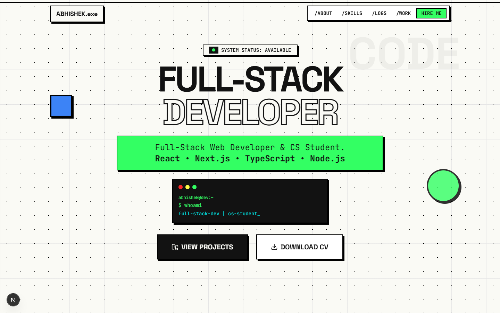
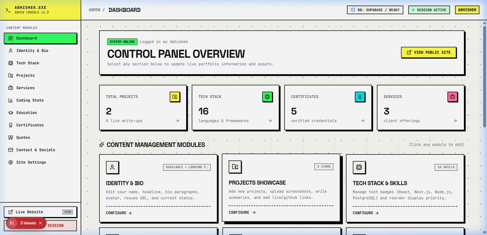

# ⚡ Neo-Brutalist Developer Portfolio & Headless CMS

[](https://nextjs.org/)
[](https://react.dev/)
[](https://www.typescriptlang.org/)
[](https://tailwindcss.com/)
[](https://supabase.com/)
[](LICENSE)

A production-grade, neo-brutalist personal portfolio and integrated content management dashboard. Built for modern software engineers, developers, and creators who demand striking visual identity paired with seamless, real-time content control.

<br />

<p align="center">
  
</p>
<p align="center">
  <em>Public Facing Neo-Brutalist Developer Portfolio</em>
</p>

<br />

<p align="center">
  
</p>
<p align="center">
  <em>Integrated Headless Admin CMS Dashboard (<code>/admin</code>)</em>
</p>

---

## 🌟 Key Highlights

- **🎨 Neo-Brutalist Design System**: High-contrast borders, tactile drop shadows (`--shadow-hard`), vibrant accent tags (`--neo-green`, `--neo-yellow`, `--neo-purple`), and responsive micro-interactions.
- **🎛️ Integrated Headless Admin Panel**: Full CMS dashboard under `/admin` to modify identity, projects, tech stack, services, coding stats, education, certifications, and rotating quotes in real time.
- **🗄️ Supabase PostgreSQL with Resilient Fallback**: Connects to Supabase for dynamic cloud persistence. If Supabase is offline or unconfigured, it automatically falls back to local static files (`content/*.ts`) without breaking the UI.
- **📸 Cloudinary & Local Asset Pipeline**: Drag-and-drop media uploader that uploads directly to Cloudinary CDN, with automatic fallback to `/public/uploads` for local development.
- **🔒 Secure Stateless Auth**: Authenticated admin session management using HTTP-only encrypted JWT tokens via `jose` (HS256) and Next.js 16 route protection.
- **🧪 Tested**: Unit and component tests with **Vitest** + **React Testing Library** (public site and content are well covered; the admin CMS and server actions are not yet covered, contributions welcome) and **Playwright** E2E smoke tests.
- **🌐 SEO & Accessibility**: Semantic HTML5 tags, JSON-LD structured data, metadata generators, and high-contrast WCAG-compliant design.

---

## 🧱 Tech Stack

| Domain | Technology |
|---|---|
| **Framework** | [Next.js 16](https://nextjs.org) (App Router, Server Actions, Partial Prefetching) |
| **UI Library** | [React 19](https://react.dev) |
| **Styling** | [Tailwind CSS v4](https://tailwindcss.com) + Custom Neo-Brutalist Utility Classes |
| **Database** | [Supabase](https://supabase.com) (PostgreSQL with Row Level Security) |
| **Media Storage** | [Cloudinary](https://cloudinary.com) + Local Filesystem Fallback |
| **Authentication** | Stateless JWT via `jose` + HTTP-Only Cookie Session |
| **Validation** | [Zod v4](https://zod.dev) Schema Validation |
| **Icons** | [Lucide React](https://lucide.dev) |
| **Unit & Integration Tests**| [Vitest](https://vitest.dev) + `@testing-library/react` |
| **End-to-End Tests** | [Playwright](https://playwright.dev) |

---

## 🚀 Quick Start

### 1. Clone the Repository
```bash
git clone https://github.com/itsawesomeabhishek/portfolio-website.git
cd portfolio-website
```

### 2. Install Dependencies
```bash
npm install
```

### 3. Configure Environment Variables
Copy the template configuration file:
```bash
cp .env.example .env.local
```

Edit `.env.local` to set your desired credentials:
```env
# Admin Credentials
ADMIN_EMAIL="admin@example.com"
ADMIN_PASSWORD="change-me-to-a-strong-password"
JWT_SECRET="generate-a-secure-random-secret-key-at-least-32-characters-long"
```
> **Note**: Supabase and Cloudinary keys are optional for local development. If omitted, the website automatically operates using static files (`content/*.ts`) and local disk uploads (`/public/uploads`).

### 4. Run Development Server
```bash
npm run dev
```

Open [http://localhost:3000](http://localhost:3000) in your browser.

---

## 🎛️ Admin Dashboard

Access the admin dashboard at:
👉 **[http://localhost:3000/admin](http://localhost:3000/admin)**

Unauthenticated visits are automatically redirected to `/admin/login`. Log in using the credentials defined in your `.env.local`:

> **Security**: `.env.example` contains placeholders only. Set your own strong `ADMIN_PASSWORD` and a random `JWT_SECRET` (32+ characters) before deploying, and never commit `.env.local`.

### Admin Modules
- **Identity & Bio**: Personal name, tagline, availability status, avatar, resume link, and bio paragraphs.
- **Projects**: Live URLs, GitHub repositories, featured flags, display ordering, and tech tags.
- **Tech Stack**: Categorized skills (Languages, Frameworks, Cloud & DevOps, Databases) with icon names.
- **Services & Offerings**: Client offerings, deliverables, and icons.
- **Coding Stats**: Dynamic metrics for LeetCode, GitHub streaks, HackerRank, and projects delivered.
- **Education & Degrees**: Timeline items with institutional info, degrees, and dates.
- **Certifications**: Verified credentials, issuing organizations, and verification links.
- **Quotes**: Rotating philosophy and inspirational quotes.
- **Contact & Socials**: Direct email, social media links (GitHub, LinkedIn, Twitter, etc.).
- **System Settings**: Diagnostic panel verifying Supabase, Cloudinary, and local storage connectivity.

---

## 🗄️ Setting Up Supabase (Optional)

To enable persistent cloud database synchronization:

1. Create a free project at [supabase.com](https://supabase.com).
2. Go to the **SQL Editor** in your Supabase project dashboard.
3. Open [`supabase-schema.sql`](supabase-schema.sql) in this repository, copy the full contents, and execute the SQL query to create the 12 tables and RLS security policies.
4. Copy your Supabase URL, Anon Key, and Service Role Key into `.env.local`:
   ```env
   NEXT_PUBLIC_SUPABASE_URL="https://xyzcompany.supabase.co"
   NEXT_PUBLIC_SUPABASE_ANON_KEY="eyJhbGciOi..."
   SUPABASE_SERVICE_ROLE_KEY="eyJhbGciOi..."
   ```
5. Seed your Supabase database with your initial portfolio content:
   ```bash
   npm run seed
   ```

---

## 📂 Project Structure

```
├── app/
│   ├── page.tsx              # Public portfolio landing page
│   ├── layout.tsx            # Root layout, fonts, metadata
│   ├── globals.css           # Tailwind CSS v4 design tokens & theme
│   ├── admin/                # Headless Admin CMS (identity, projects, stack, ...)
│   └── api/upload/           # Cloudinary / local upload route
├── components/
│   ├── admin/                # Admin UI components
│   ├── chrome/               # Navbar, boot screen, scroll progress
│   ├── sections/             # Landing page sections
│   └── ui/                   # Shared UI primitives
├── content/                  # Static content (edit these to make it yours)
├── e2e/                      # Playwright end-to-end tests
├── lib/
│   ├── actions/              # Server Actions (auth, content mutations)
│   ├── auth-session.ts       # Stateless JWT cookie session
│   ├── cloudinary.ts         # Cloudinary client
│   ├── data.ts               # Data fetcher (Supabase with static fallback)
│   ├── supabase.ts           # Supabase client
│   └── validators.ts         # Zod schemas
├── public/                   # Images, resume, certificates (replace with yours)
├── scripts/seed-supabase.mjs # Database seeder
├── supabase-schema.sql       # PostgreSQL schema & RLS policies
└── proxy.ts                  # Next.js 16 admin route protection
```

Unit tests live next to the code they cover (`*.test.ts(x)`).

---

## 🎨 Make It Yours

1. Edit the files in `content/` (identity, projects, stack, services, stats, contact).
2. Replace the personal assets in `public/` (`assets/`, `certificates/`, `project/`, `resume/`, `screenshots/`).
3. Update the site metadata in `app/layout.tsx`.

---

## 🛠️ Available Scripts

| Script | Command | Purpose |
|---|---|---|
| `npm run dev` | `next dev` | Start development server on port 3000 |
| `npm run build` | `next build` | Build optimized production bundle |
| `npm run start` | `next start` | Run production server |
| `npm run typecheck` | `tsc --noEmit` | Validate TypeScript types across all files |
| `npm run lint` | `eslint` | Run ESLint static analysis |
| `npm test` | `vitest run` | Run all unit and integration tests |
| `npm run test:watch` | `vitest` | Run unit tests in interactive watch mode |
| `npm run test:coverage`| `vitest run --coverage`| Generate unit test coverage report |
| `npm run test:e2e` | `playwright test` | Run Playwright end-to-end browser tests |
| `npm run seed` | `node scripts/seed-supabase.mjs`| Seed Supabase database with initial content |

## 📈 Star History

<a href="https://star-history.com/#itsawesomeabhishek/portfolio-website&Date">
 <picture>
   <source media="(prefers-color-scheme: dark)" srcset="https://api.star-history.com/svg?repos=itsawesomeabhishek/portfolio-website&type=Date&theme=dark" />
   <source media="(prefers-color-scheme: light)" srcset="https://api.star-history.com/svg?repos=itsawesomeabhishek/portfolio-website&type=Date" />
   
 </picture>
</a>

---

## 🤝 Contributing

Contributions, issues, and feature requests are welcome!  
Please read our [Contributing Guide](CONTRIBUTING.md) and [Code of Conduct](CODE_OF_CONDUCT.md) before submitting a pull request.

1. Fork the Project
2. Create your Feature Branch (`git checkout -b feature/AmazingFeature`)
3. Commit your Changes (`git commit -m 'feat: add some AmazingFeature'`)
4. Push to the Branch (`git push origin feature/AmazingFeature`)
5. Open a Pull Request

---

## 🛡️ Security

If you discover a security vulnerability, please review our [Security Policy](SECURITY.md) before reporting it publicly.

---

## 📄 License

This project is open-source and distributed under the [MIT License](LICENSE). You are free to use, modify, and distribute this template for personal or commercial projects.
